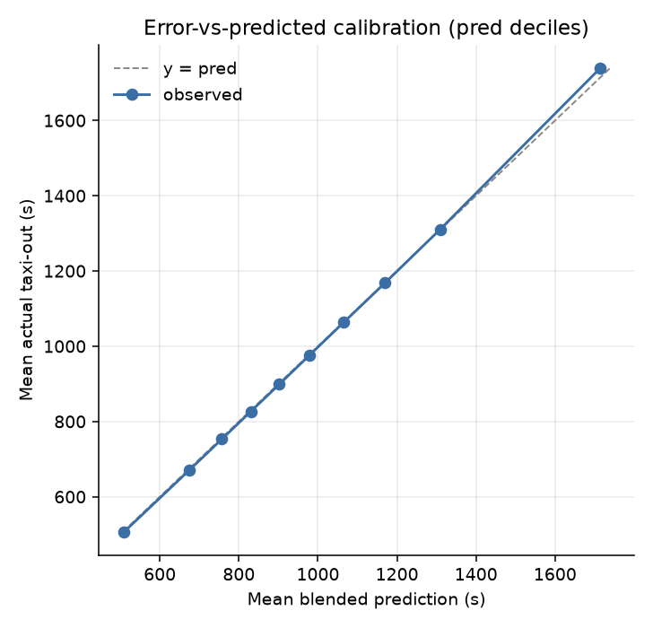
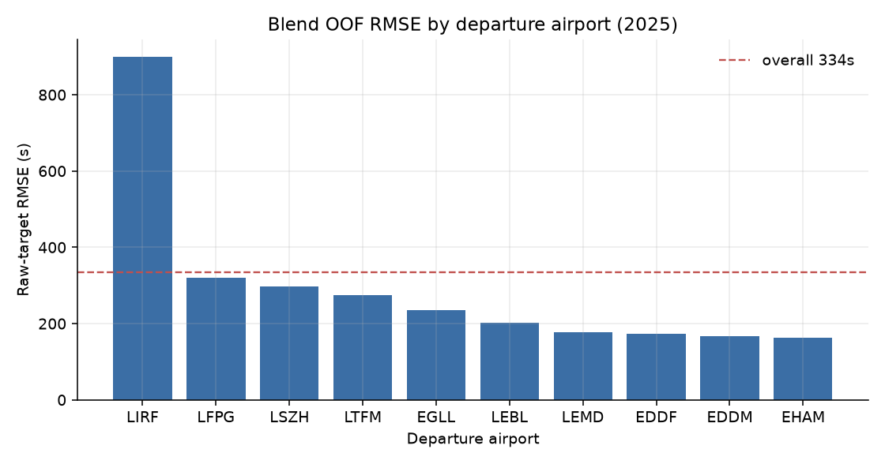
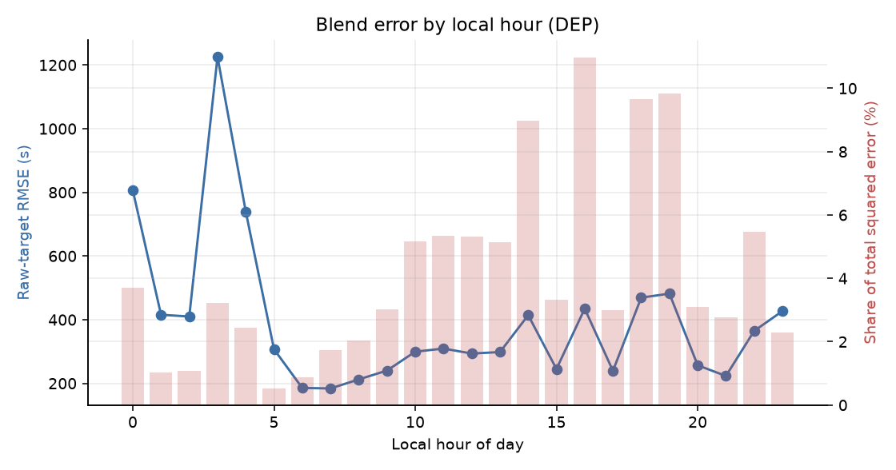
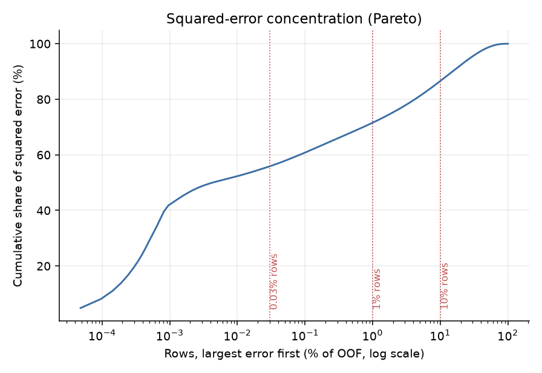
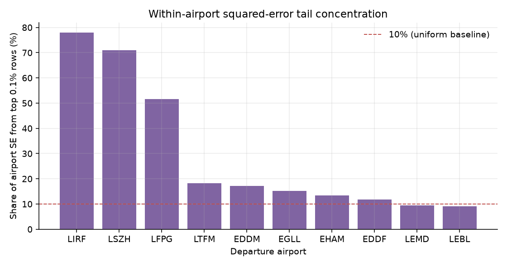

# Error Analysis — Task 4.1 (blend OOF, 2025)

Team: `thoughtful-glove` · Generated: 2026-10-03 19:44 PST · Machine: Mac Mini M4 Pro

Source: `data/processed/oof_predictions.parquet` (2,085,047 rows) joined to training DEP segment keys; blend = tuned_lgbm·0.4329 + per_airport_lgbm·0.5671 (from `src/configs/blend.json`).

## 0. Reproduction gate

- Recomputed blend OOF raw RMSE: **333.81s** (recorded `selected.rmse` = 333.81s; asserted |Δ| < 0.01s).
- Season-matched (Jan+Jul 2025) OOF raw RMSE: **455.11s** (344,419 rows).
- Join coverage: 2,085,047/2,085,047 OOF rows matched to a training DEP row (100%).

## 1. Overall error structure

- Overall RMSE **333.81s**, MAE **145.94s**, mean bias **-0.31s** (negative = model under-predicts on average).
- Total squared error: 232,341,630,736s².

**Squared-error concentration (whole OOF).**

| Largest-error rows | Share of total squared error |
|---|---:|
| top 0.03% (625 rows) | 55.9% |
| top 0.10% (2,085 rows) | 60.8% |
| top 1.00% (20,850 rows) | 71.6% |
| top 5.00% (104,252 rows) | 81.2% |

**Within-airport tail concentration (top 0.1% rows per airport).**

| Airport | Rows | RMSE (s) | Tail rows (0.1%) | Airport SE from tail (%) |
|---|---|---|---|---|
| LIRF | 160,704 | 899.22 | 160 | 78.0 |
| LSZH | 134,907 | 297.93 | 134 | 71.0 |
| LFPG | 239,552 | 319.16 | 239 | 51.5 |
| LTFM | 272,965 | 274.71 | 272 | 18.3 |
| EDDM | 167,334 | 166.14 | 167 | 17.2 |
| EGLL | 239,546 | 235.96 | 239 | 15.3 |
| EHAM | 247,951 | 161.90 | 247 | 13.3 |
| EDDF | 230,141 | 173.47 | 230 | 11.8 |
| LEMD | 212,242 | 177.91 | 212 | 9.4 |
| LEBL | 179,705 | 201.85 | 179 | 9.2 |

## 2. Decomposition by segment

### 2a. By departure airport (all 10)

| Airport | Rows | RMSE (s) | MAE (s) | Bias (s) | SE share (%) |
|---|---|---|---|---|---|
| LIRF | 160,704 | 899.22 | 251.10 | -6.7 | 55.93 |
| LFPG | 239,552 | 319.16 | 158.82 | +2.0 | 10.50 |
| LTFM | 272,965 | 274.71 | 171.93 | -2.7 | 8.87 |
| EGLL | 239,546 | 235.96 | 162.66 | +0.3 | 5.74 |
| LSZH | 134,907 | 297.93 | 119.07 | +0.1 | 5.15 |
| LEBL | 179,705 | 201.85 | 134.14 | +1.1 | 3.15 |
| EDDF | 230,141 | 173.47 | 120.07 | +0.2 | 2.98 |
| LEMD | 212,242 | 177.91 | 124.99 | +0.8 | 2.89 |
| EHAM | 247,951 | 161.90 | 109.27 | +0.7 | 2.80 |
| EDDM | 167,334 | 166.14 | 110.93 | +0.4 | 1.99 |

### 2b. By fold month (2025)

| Month | Rows | RMSE (s) | MAE (s) | Bias (s) | SE share (%) |
|---|---|---|---|---|---|
| 2025-07 | 190,713 | 503.27 | 169.35 | -0.4 | 20.79 |
| 2025-06 | 183,142 | 366.53 | 148.37 | +2.0 | 10.59 |
| 2025-01 | 153,706 | 387.12 | 144.51 | +10.8 | 9.91 |
| 2025-02 | 143,732 | 396.83 | 146.85 | -10.5 | 9.74 |
| 2025-09 | 183,950 | 328.45 | 150.15 | +3.4 | 8.54 |
| 2025-08 | 191,182 | 297.67 | 151.12 | +1.2 | 7.29 |
| 2025-05 | 185,202 | 300.47 | 139.53 | -4.4 | 7.20 |
| 2025-11 | 162,332 | 319.69 | 139.45 | -2.5 | 7.14 |
| 2025-12 | 165,677 | 280.95 | 142.93 | +5.5 | 5.63 |
| 2025-03 | 164,449 | 259.52 | 135.51 | -5.6 | 4.77 |
| 2025-10 | 185,674 | 238.36 | 145.15 | -0.8 | 4.54 |
| 2025-04 | 175,288 | 226.20 | 134.57 | -3.1 | 3.86 |

### 2c. By airport × runway (top 15 by SE share, n ≥ 2,000)

| Airport | Runway | Rows | RMSE (s) | Bias (s) | SE share (%) |
|---|---|---|---|---|---|
| LIRF | 25 | 144,747 | 877.64 | -3.9 | 47.99 |
| LIRF | 34L | 4,139 | 1636.43 | -68.0 | 4.77 |
| LFPG | 08L | 75,184 | 383.93 | +1.9 | 4.77 |
| LSZH | 28 | 84,800 | 343.92 | +0.2 | 4.32 |
| LFPG | 26R | 71,936 | 328.95 | +0.5 | 3.35 |
| LTFM | 35L | 79,873 | 302.62 | -1.9 | 3.15 |
| LIRF | 16R | 11,219 | 766.72 | -18.8 | 2.84 |
| LTFM | 36 | 126,157 | 211.69 | +4.8 | 2.43 |
| EGLL | 27R | 77,027 | 246.70 | +0.3 | 2.02 |
| LEBL | 24L | 124,514 | 193.07 | +1.5 | 2.00 |
| EGLL | 09R | 87,565 | 229.64 | -1.2 | 1.99 |
| LTFM | 34L | 8,796 | 694.51 | -153.9 | 1.83 |
| EDDF | 18 | 140,022 | 170.02 | +0.4 | 1.74 |
| EGLL | 27L | 74,841 | 230.86 | +2.1 | 1.72 |
| LEMD | 36L | 84,203 | 177.61 | +1.5 | 1.14 |

### 2d. By local hour of day (24 buckets)

| Local hour | Rows | RMSE (s) | Bias (s) | SE share (%) |
|---|---|---|---|---|
| 0 | 13,186 | 806.79 | -3.1 | 3.69 |
| 1 | 13,996 | 415.50 | +6.7 | 1.04 |
| 2 | 14,757 | 409.97 | -4.8 | 1.07 |
| 3 | 4,974 | 1225.65 | -44.0 | 3.22 |
| 4 | 10,340 | 739.87 | -20.6 | 2.44 |
| 5 | 12,886 | 307.07 | -5.5 | 0.52 |
| 6 | 58,814 | 185.64 | -0.4 | 0.87 |
| 7 | 118,726 | 183.98 | +0.2 | 1.73 |
| 8 | 104,513 | 212.34 | +2.8 | 2.03 |
| 9 | 121,516 | 240.21 | -0.5 | 3.02 |
| 10 | 133,902 | 299.49 | -3.4 | 5.17 |
| 11 | 130,036 | 309.32 | -2.3 | 5.35 |
| 12 | 143,331 | 293.66 | -0.2 | 5.32 |
| 13 | 133,922 | 298.31 | +2.6 | 5.13 |
| 14 | 121,603 | 414.17 | -0.5 | 8.98 |
| 15 | 128,557 | 245.11 | +3.6 | 3.32 |
| 16 | 134,943 | 434.54 | -3.0 | 10.97 |
| 17 | 121,182 | 239.30 | -0.1 | 2.99 |
| 18 | 101,971 | 469.23 | +2.6 | 9.66 |
| 19 | 98,516 | 481.91 | -0.2 | 9.85 |
| 20 | 109,437 | 256.84 | +0.0 | 3.11 |
| 21 | 129,218 | 223.15 | +2.9 | 2.77 |
| 22 | 95,647 | 364.80 | -3.8 | 5.48 |
| 23 | 29,074 | 426.92 | -5.2 | 2.28 |

### 2e. By aircraft type (top 15 by SE share, n ≥ 2,000)

| Aircraft type | Rows | RMSE (s) | Bias (s) | SE share (%) |
|---|---|---|---|---|
| A320 | 342,973 | 236.91 | +1.8 | 8.29 |
| B738 | 218,514 | 278.01 | +0.8 | 7.27 |
| A319 | 134,678 | 303.70 | +1.1 | 5.35 |
| A21N | 149,245 | 254.48 | -1.3 | 4.16 |
| A321 | 162,231 | 218.71 | +0.6 | 3.34 |
| C56X | 4,125 | 1365.48 | -17.9 | 3.31 |
| A20N | 169,768 | 211.73 | +0.6 | 3.28 |
| B77W | 67,204 | 267.88 | -0.3 | 2.08 |
| B789 | 61,322 | 241.26 | -0.4 | 1.54 |
| A359 | 56,394 | 248.17 | -0.2 | 1.49 |
| A333 | 47,161 | 267.91 | -4.0 | 1.46 |
| BCS3 | 77,321 | 201.64 | -0.4 | 1.35 |
| B38M | 45,247 | 240.19 | -1.9 | 1.12 |
| A332 | 31,981 | 277.04 | -3.4 | 1.06 |
| E190 | 78,863 | 174.24 | +0.7 | 1.03 |

### 2f. By operator (top 15 by SE share, n ≥ 2,000)

| Operator | Rows | RMSE (s) | Bias (s) | SE share (%) |
|---|---|---|---|---|
| __NA__ | 22,470 | 2393.60 | -86.1 | 55.41 |
| 95828822709b52d2167a5400012d395c3cf1c2978c05e5cc41dccf6fcf559188 | 222,550 | 244.90 | -1.3 | 5.74 |
| 8e92b7d7ac51748efe185c21ae9d676c546d239f3a23d9240e98cb59ff928eab | 120,747 | 241.36 | -0.1 | 3.03 |
| 48910dcb821117a444345fed5c3a6252fbd8001e57ccbf6a8de57789aaf1a459 | 8,002 | 928.95 | -7.7 | 2.97 |
| aa14d43dcaf7a26218c748bd3eda94f0dd97825d6cfb8add45b5f11c8cfc9560 | 140,388 | 218.41 | +1.5 | 2.88 |
| 11dca3faf5500fdddbb17189b5d18bcdc763244fcc850c62a7f4a597bb9a486f | 222,892 | 163.61 | +0.4 | 2.57 |
| 65b92f7aceccfa29f570209f189d1d2471db6ea69b035e01424f5bacec566c71 | 52,396 | 278.41 | +3.4 | 1.75 |
| 4c1c009e61262f296b0e892f491e2225350d7d88ef02aa3bad4fa6182507762c | 86,686 | 208.31 | +1.2 | 1.62 |
| 3ba01c3b2192b97eabf11a7fb3cc50d55440d2cd6c29069fe278595c2581b41f | 69,958 | 230.95 | +2.0 | 1.61 |
| 6251e0eec78fc5b8317bec9b1a8d4d06f3cadfc4d147afc3405964d6adb19374 | 141,486 | 151.88 | +0.9 | 1.40 |
| 15411f3d2b871015c95769cd30aecfb523d203b1f4d1cc0875d24545cb1261ae | 19,834 | 384.54 | -3.0 | 1.26 |
| 813bafd420ebe84b781f8b5a8e907093746a0c8cf12799884f8ef97def759521 | 78,044 | 171.71 | +1.2 | 0.99 |
| 4ac51f35907034e876650c22087170ecdb411f4dbfbe8ccce288f9bd7caf3bdd | 62,341 | 190.18 | +1.0 | 0.97 |
| 944cfcce3c8ae26d7d161d2c9ecaaddca2fd6663ecde77a311cf3bf35c4ecc83 | 18,269 | 289.82 | -1.5 | 0.66 |
| 1901074fe2ac2c5bce71167f8b2141b483c06d93b6dacab5a0cbce204d7b6704 | 37,211 | 202.59 | +3.0 | 0.66 |

### 2g. By stand zone (top 15 by SE share, n ≥ 2,000)

| Stand zone | Rows | RMSE (s) | Bias (s) | SE share (%) |
|---|---|---|---|---|
| N70 | 13,725 | 1249.79 | -20.7 | 9.23 |
| N60 | 13,352 | 1255.97 | -21.0 | 9.07 |
| N30 | 61,404 | 491.90 | +1.5 | 6.39 |
| N23 | 40,049 | 495.31 | +0.7 | 4.23 |
| N40 | 39,642 | 489.26 | +3.7 | 4.08 |
| N10 | 31,054 | 544.83 | -4.0 | 3.97 |
| D | 127,159 | 269.16 | -0.2 | 3.96 |
| N71 | 4,349 | 1453.20 | -36.9 | 3.95 |
| C | 61,367 | 386.71 | -0.4 | 3.95 |
| N82 | 4,023 | 1448.36 | -52.3 | 3.63 |
| N22 | 50,133 | 399.17 | +0.2 | 3.44 |
| N31 | 49,737 | 395.28 | +0.4 | 3.34 |
| B | 158,306 | 219.30 | -0.6 | 3.28 |
| N32 | 34,549 | 466.61 | -2.4 | 3.24 |
| F | 135,038 | 233.18 | -0.9 | 3.16 |

### 2h. By UTC hour of day (24 buckets)

| UTC hour | Rows | RMSE (s) | Bias (s) | SE share (%) |
|---|---|---|---|---|
| 0 | 5,026 | 698.05 | -19.3 | 1.05 |
| 1 | 4,506 | 1288.52 | -40.2 | 3.22 |
| 2 | 7,424 | 412.09 | -14.8 | 0.54 |
| 3 | 18,584 | 542.59 | -4.6 | 2.35 |
| 4 | 49,775 | 193.99 | +2.5 | 0.81 |
| 5 | 95,282 | 192.45 | -0.2 | 1.52 |
| 6 | 98,340 | 202.58 | -0.8 | 1.74 |
| 7 | 104,845 | 241.74 | -1.5 | 2.64 |
| 8 | 125,479 | 304.65 | -0.7 | 5.01 |
| 9 | 137,602 | 245.78 | -2.8 | 3.58 |
| 10 | 141,119 | 337.23 | -1.2 | 6.91 |
| 11 | 141,394 | 253.07 | +2.2 | 3.90 |
| 12 | 130,182 | 386.70 | -0.3 | 8.38 |
| 13 | 123,955 | 325.98 | +3.3 | 5.67 |
| 14 | 130,623 | 407.36 | -2.6 | 9.33 |
| 15 | 124,920 | 287.80 | +3.3 | 4.45 |
| 16 | 112,059 | 319.83 | +1.8 | 4.93 |
| 17 | 98,892 | 489.19 | -0.5 | 10.19 |
| 18 | 103,249 | 415.84 | +1.5 | 7.68 |
| 19 | 114,871 | 231.89 | +0.3 | 2.66 |
| 20 | 111,613 | 338.01 | -2.4 | 5.49 |
| 21 | 57,577 | 329.95 | -2.9 | 2.70 |
| 22 | 28,995 | 551.29 | +1.8 | 3.79 |
| 23 | 18,735 | 425.87 | -5.8 | 1.46 |

## 3. Error vs predicted (calibration)

| Pred decile | Rows | Mean pred (s) | Mean actual (s) | Bias (s) | RMSE (s) |
|---|---|---|---|---|---|
| 0 | 208,505 | 509 | 507 | +2.9 | 228.6 |
| 1 | 208,505 | 674 | 670 | +3.9 | 133.6 |
| 2 | 208,504 | 757 | 753 | +3.8 | 146.2 |
| 3 | 208,505 | 830 | 827 | +3.5 | 162.2 |
| 4 | 208,505 | 902 | 899 | +3.4 | 176.9 |
| 5 | 208,504 | 978 | 976 | +2.4 | 231.1 |
| 6 | 208,505 | 1065 | 1064 | +1.8 | 282.4 |
| 7 | 208,504 | 1170 | 1168 | +1.4 | 231.3 |
| 8 | 208,505 | 1309 | 1311 | -1.4 | 268.1 |
| 9 | 208,505 | 1714 | 1738 | -24.8 | 840.7 |

## 4. Top-3 error-contributing segments

**S1. LIRF / runway 25** — 144,747 rows, RMSE 877.6s, bias -3.9s, **47.99% of total OOF squared error**.
**S2. LIRF / runway 34L** — 4,139 rows, RMSE 1636.4s, bias -68.0s, **4.77% of total OOF squared error**.
**S3. LFPG / runway 08L** — 75,184 rows, RMSE 383.9s, bias +1.9s, **4.77% of total OOF squared error**.

## 5. Micro-iteration candidates (ranked)

In-sample post-processing headroom per airport (upper bounds — honest leave-one-month-out verdicts are produced by `src/run_micro_iterations.py`):

| Airport | Bias (s) | RMSE global-w | w* opt | RMSE opt-w | Gain w | Slope | RMSE affine | Gain affine | Cap q | Gain cap |
|---|---|---|---|---|---|---|---|---|---|---|
| LIRF | -6.7 | 899.2 | 0.468 | 899.2 | +0.04 | 1.217 | 881.4 | +17.82 | 1.0000 | +0.00 |
| LTFM | -2.7 | 274.7 | 0.572 | 274.5 | +0.23 | 1.107 | 272.8 | +1.88 | 1.0000 | +0.00 |
| EDDM | +0.4 | 166.1 | 0.232 | 165.7 | +0.43 | 1.022 | 166.0 | +0.09 | 1.0000 | +0.00 |
| LFPG | +2.0 | 319.2 | 0.491 | 319.1 | +0.04 | 1.020 | 319.1 | +0.07 | 1.0000 | +0.00 |
| EDDF | +0.2 | 173.5 | 0.290 | 173.3 | +0.17 | 1.017 | 173.4 | +0.06 | 1.0000 | +0.00 |
| LEBL | +1.1 | 201.9 | 0.339 | 201.8 | +0.07 | 1.017 | 201.8 | +0.05 | 1.0000 | +0.00 |
| LEMD | +0.8 | 177.9 | 0.219 | 177.6 | +0.35 | 1.013 | 177.9 | +0.03 | 1.0000 | +0.00 |
| EHAM | +0.7 | 161.9 | 0.218 | 161.5 | +0.38 | 1.011 | 161.9 | +0.03 | 1.0000 | +0.00 |
| LSZH | +0.1 | 297.9 | 0.271 | 297.7 | +0.19 | 1.009 | 297.9 | +0.01 | 1.0000 | +0.00 |
| EGLL | +0.3 | 236.0 | 0.397 | 235.9 | +0.01 | 1.001 | 236.0 | +0.00 | 1.0000 | +0.00 |

Per-airport component agreement:

| Airport | RMSE tuned | RMSE per-airport | RMSE blend | Residual corr |
|---|---|---|---|---|
| LIRF | 908.1 | 906.1 | 899.2 | 0.965 |
| LFPG | 321.8 | 321.6 | 319.2 | 0.968 |
| LSZH | 301.7 | 298.3 | 297.9 | 0.976 |
| LTFM | 276.6 | 278.3 | 274.7 | 0.958 |
| EGLL | 239.2 | 237.4 | 236.0 | 0.963 |
| LEBL | 205.2 | 202.7 | 201.9 | 0.961 |
| LEMD | 182.2 | 177.9 | 177.9 | 0.958 |
| EDDF | 177.4 | 174.0 | 173.5 | 0.955 |
| EDDM | 171.8 | 166.3 | 166.1 | 0.939 |
| EHAM | 166.4 | 161.9 | 161.9 | 0.951 |

## 6. Tail drill-down (who the extreme errors are)

The top 0.03% rows (625) carry the bulk of squared error. **78.9%** of those rows have a missing operator ID.

**Extreme-tail rows by airport.**

| Airport | Tail rows |
|---|---|
| LIRF | 437 |
| LTFM | 93 |
| LFPG | 39 |
| EGLL | 32 |
| LSZH | 10 |
| EDDM | 8 |
| EHAM | 4 |
| EDDF | 2 |

**Extreme-tail rows by airport × runway (top 10).**

| Airport | Runway | Tail rows |
|---|---|---|
| LIRF | 25 | 389 |
| LTFM | 34L | 69 |
| LIRF | 16R | 29 |
| LTFM | 35L | 18 |
| EGLL | 27R | 16 |
| LIRF | 34L | 13 |
| LFPG | 26R | 13 |
| EGLL | 09R | 12 |
| LFPG | 08L | 10 |
| LFPG | 09R | 9 |

**Missing-operator subgroup** (`AIRCRAFT_OPERATOR_flt` null): 22,470 rows (1.08% of OOF) carry **55.4% of all squared error**.

| Airport | Rows | RMSE (s) | Global SE share (%) |
|---|---|---|---|
| LIRF | 1,488 | 8336.1 | 44.50 |
| LFPG | 3,773 | 1737.8 | 4.90 |
| LSZH | 2,291 | 1893.2 | 3.53 |
| LTFM | 3,645 | 947.8 | 1.41 |
| EGLL | 1,414 | 921.3 | 0.52 |
| EHAM | 4,084 | 337.2 | 0.20 |
| EDDM | 1,010 | 578.1 | 0.15 |
| EDDF | 1,956 | 325.5 | 0.09 |
| LEBL | 1,862 | 307.2 | 0.08 |
| LEMD | 947 | 274.9 | 0.03 |

**Top-segment drill-down** (is the segment's error the special flights?):

| Airport | Runway | Rows | RMSE (s) | Bias (s) | SE share (%) | Segment SE from missing-op (%) | RMSE excl. missing-op (s) | Global-tail rows here |
|---|---|---|---|---|---|---|---|---|
| LIRF | 25 | 144,747 | 877.6 | -3.9 | 47.99 | 78.4 | 409.8 | 1,111 |
| LIRF | 34L | 4,139 | 1636.4 | -68.0 | 4.77 | 93.4 | 423.4 | 42 |
| LFPG | 08L | 75,184 | 383.9 | +1.9 | 4.77 | 64.3 | 230.9 | 41 |

## 7. Figures

_All figures generated by `src/run_error_analysis.py`; all tables are script-computed._
